I built a working signed multiply-accumulate (MAC) unit on a low-cost FPGA board, ran it on real hardware, and got `RESULT: PASS` on the first board run. This post shows every step, from an empty Windows PC to numbers coming back from the FPGA, written for someone who has never touched an FPGA tool before.

## What is a MAC, and why build one?

A MAC does one tiny job over and over: **multiply two numbers and add the result to a running total**.

```
acc = acc + (a × b)
```

That one line is the heart of almost every digital filter, every audio effect and every neural-network layer. A dot product is just a MAC repeated: `1×4 + (−2)×5 + 3×(−6)` is three MACs in a row. Phones and AI chips contain thousands of MAC units for exactly this reason.

Building one yourself is the perfect first "real" FPGA project. It is small enough to finish in an evening, but it teaches the things every FPGA design needs: signed numbers, overflow, clocks, pipelining, talking to a microcontroller, pin mapping and checking timing.

## What you will end up with

- An FPGA that keeps a 32-bit running total and multiplies two signed 8-bit numbers on every request.
- A MicroPython program on the board's RP2040 that loads the FPGA, sends numbers and prints the result.
- No extra wires: everything uses connections already on the Shrike Lite board.

| | |
| --- | --- |
| **Difficulty** | Beginner (first or second FPGA project) |
| **Time** | About 3–4 hours the first time, including software installs |
| **Cost** | One Vicharak Shrike Lite board and a USB-C data cable |
| **You should know** | Basic Verilog (`always`, `assign`, `<=`) and basic Python |
| **You do not need** | Any previous FPGA tool experience, a JTAG programmer, or jumper wires |

## Project specifications

These are the targets I set before writing a single line of code. Every one of them was met and tested on the board.

| Item | Specification | Why |
| --- | --- | --- |
| Inputs `a`, `b` | Signed 8-bit, two's complement, −128 to 127 | One byte each, so each fits in one SPI byte; the same range as int8 in small neural networks |
| Product | Signed 16-bit, exact | The extremes are (−128)×(−128) = +16 384 and −128×127 = −16 256, both fit in 16 bits, so nothing is ever rounded |
| Accumulator | Signed 32-bit | Needs at least 131 072 worst-case MACs before it can overflow |
| Overflow | Wrap around + a sticky OVF flag | The value wraps like normal two's-complement hardware, and a flag stays on so the error is never hidden |
| Commands | CLEAR, MAC, READ | Start a new total, add one product, read the total back |
| Initialisation | CLEAR is mandatory before the first MAC | A MAC sent before CLEAR is refused, so you never add to a garbage starting value |
| Bad inputs | Rejected, never wrapped | 128 must not silently become −128 |
| Link | SPI over the board's built-in RP2040–FPGA wires | No jumper wires needed |
| Clock | 50 MHz on-chip oscillator | No external crystal needed |

## Why I needed this (and why you might too)

I wanted a first project that was more than blinking an LED but still small enough to understand completely. A MAC hits the sweet spot:

- **It is useful.** It is the building block of DSP and machine-learning accelerators.
- **It exercises both chips.** The FPGA does the hardware maths; the microcontroller does everything "software".
- **It forces good habits.** You have to think about signed numbers, overflow, clocks crossing between chips, and how to prove the design is correct.

## Difficulty for a beginner

I would rate this **2 out of 5** if you follow this guide step by step.

| Part | Difficulty | What makes it tricky |
| --- | --- | --- |
| Installing the software | Easy | A Renesas account is needed for the FPGA tool |
| Understanding the Verilog | Medium | Signed maths, synchronisers and edge detection are new ideas |
| Go Configure (FPGA tool) | Easy–medium | The screens differ slightly from older tutorials; pin mapping needs care |
| MicroPython side | Easy | Copy four files and press Run |
| Debugging if it fails | Medium | The guide's status codes make most problems easy to spot |

## Meet the board: Vicharak Shrike Lite

The Shrike Lite puts two chips on one small board: a **Raspberry Pi RP2040** microcontroller and a **Renesas ForgeFPGA SLG47910V**. The RP2040 runs MicroPython and loads the FPGA; the FPGA runs whatever hardware you design in Verilog.

| Part | Detail |
| --- | --- |
| FPGA | Renesas SLG47910V (Rev BB), 1120 LUTs, 1120 flip-flops |
| FPGA memory | 32 kb block RAM, 5 kb distributed RAM (not used here) |
| FPGA clock | Built-in 50 MHz oscillator, plus one PLL (not used here) |
| Hard multiplier / DSP block | **None.** The multiplier is built from ordinary logic |
| Microcontroller | RP2040, dual Cortex-M0+, MicroPython |
| Storage | 4 MB QSPI flash (holds MicroPython files and the FPGA bitstream) |
| I/O voltage | **3.3 V only.** Never connect 5 V signals to any pin |
| Power | USB-C or the 5 V header, never both |

Two facts shaped the whole design:

1. **There is no DSP block.** Big FPGAs have hard multiplier blocks; this one does not, so the 8×8 multiplier must be built from LUTs. It still fits easily (32 % of the chip, as you will see).
2. **The FPGA forgets its design at power-off.** The RP2040 sends the design (the *bitstream*) into the FPGA every time the board starts. The chip also has one-time-programmable memory, but this project never touches it.

### The built-in RP2040 ↔ FPGA link

The board already wires several RP2040 pins to FPGA pins. Four of them are used first to load the bitstream, and then become a normal SPI bus for your design. That is why this project needs no jumper wires.

| RP2040 pin | FPGA pin | While loading | In this project |
| --- | --- | --- | --- |
| GPIO13 / GPIO12 | EN / PWR | Turn the FPGA on | Used only by the loader |
| GPIO2 | GPIO3 | Config clock | SPI clock (SCK) |
| GPIO1 | GPIO4 | Config select | SPI chip select (CS, active low) |
| GPIO3 | GPIO5 | Config data in | MOSI (RP2040 → FPGA) |
| GPIO0 | GPIO6 | Config data out | MISO (FPGA → RP2040) |
| GPIO14 | GPIO18 | — | Reset for our logic (active low) |
| — | GPIO16 | — | FPGA user LED |

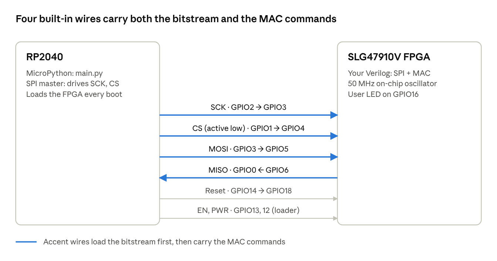
*Shrike Lite RP2040 to FPGA wiring used in this project*

The four highlighted wires do double duty: the RP2040 uses them to load the bitstream, then the same wires carry every CLEAR, MAC and READ.

## Design choices, explained simply

The RP2040 is the **SPI master**: it drives the clock and decides when to talk. The FPGA is the **SPI target** (slave): it only answers. Every message is one *frame*, which is everything sent between chip-select going low and going high.

### The command language

| Command | RP2040 sends | FPGA replies | Effect |
| --- | --- | --- | --- |
| CLEAR | `01` | `A5` | Total = 0, all flags cleared, INIT = 1 |
| MAC | `02 aa bb` | `A5 00 00` | Total = total + aa × bb |
| READ | `03 00 00 00 00 00` | `A5 A3 A2 A1 A0 ST` | Total (4 bytes, most significant first) + status byte |

SPI settings: **mode 0** (clock idles low, both sides sample on the rising edge), **MSB first**, 8-bit bytes, **1 MHz** clock.

Three small tricks make the link robust:

- **Every reply starts with `0xA5`** (binary `1010 0101`). A broken wire reads `0x00` or `0xFF`, never `0xA5`, so the RP2040 knows straight away whether the FPGA is alive.
- **SPI is full duplex.** The RP2040 receives one byte for every byte it sends, so READ sends five dummy `00` bytes to give the FPGA room to reply.
- **A command runs only when the frame ends, and only if its length is exactly right.** A broken message can never half-change the total; it is thrown away and an error flag lights up.

### The status byte

The last byte of every READ is a status code built inside the FPGA. Each bit is one warning light.

| Bit | Name | Means |
| --- | --- | --- |
| 0 | INIT | The total has been cleared and is ready |
| 1 | OVF | The total went past the 32-bit limit and wrapped |
| 2 | ERR_UNINIT | A MAC was sent before CLEAR (ignored) |
| 3 | ERR_FRAME | A frame had the wrong length (ignored) |
| 4 | ERR_CMD | Unknown command byte |
| 7–5 | `010` | Constant signature, proves the FPGA is answering |

So **65 (0x41) means "cleared, no errors"** and **64 (0x40) means "just reset, call CLEAR first"**. The FPGA's user LED turns on only when INIT is set and every error light is off.

### The clear-first rule

The total must be cleared before any arithmetic. I enforce this twice: the Python driver refuses to send a MAC until CLEAR has succeeded, and the FPGA itself refuses a MAC (and sets ERR_UNINIT) if it has not been cleared since reset. Out-of-range inputs like 128 or −129 are rejected in Python before anything is sent.

## How the FPGA design works

The Verilog is split into three files, each with one job.

| File | Job |
| --- | --- |
| `spi_byte_target.v` | Turns the wiggling SPI wires into whole bytes, and reply bytes back into wiggles |
| `top.v` | Decodes commands, checks frame length, keeps the status flags and drives the LED |
| `mac_core.v` | Multiplies, adds, keeps the 32-bit total and detects overflow |

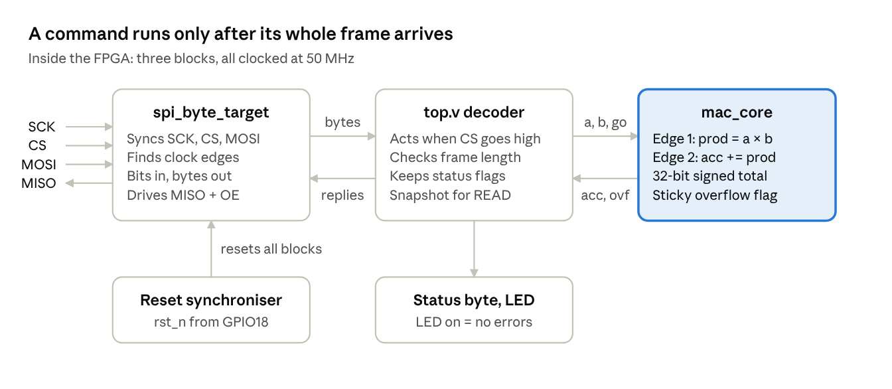
*Inside the FPGA: three blocks, left to right*

Bytes flow left to right; replies and the running total flow back. Nothing reaches the MAC core until the decoder has seen a complete, correctly sized frame.

### 1. Listening safely: synchronisers and edge detection

The RP2040's SPI clock and the FPGA's 50 MHz clock are unrelated. If SCK changes exactly on an FPGA clock edge, a flip-flop can become *metastable* (stuck between 0 and 1 for a moment). The cure is to pass every incoming signal through a short chain of flip-flops, then compare the last two clean samples to find edges:

```verilog
// three samples of SCK; a new one enters on every 50 MHz edge
always @(posedge clk or negedge rst_n)
    if (!rst_n) sck_s <= 3'b000;
    else        sck_s <= {sck_s[1:0], spi_sck};

wire sck_rise = ~sck_s[2] &  sck_s[1];   // was 0, now 1
wire sck_fall =  sck_s[2] & ~sck_s[1];   // was 1, now 0
```

On every `sck_rise` one MOSI bit is shifted in; after eight bits a full byte is announced. On every `sck_fall` the reply register shifts left so the next bit sits on MISO. The FPGA drives MISO only while CS is low, which is why the pin needs an output-enable (`spi_miso_en`).

### 2. Deciding: the command decoder

The decoder in `top.v` waits for chip-select to go high, then checks the byte count before doing anything:

```verilog
if (frame_end && byte_count != 3'd0) begin
    case (cmd)
        CMD_MAC:
            if (byte_count != 3'd3) err_frame  <= 1'b1;  // wrong length
            else if (!init)         err_uninit <= 1'b1;  // not cleared yet
            else                    mac_p      <= 1'b1;  // go: one-cycle pulse
        // CLEAR and READ are handled the same way
    endcase
end
```

The status byte is simply the flags packed together:

```verilog
wire [7:0] status = {3'b010, err_cmd, err_frame, err_uninit, ovf, init};
```

### 3. Calculating: a two-stage pipeline

Multiplying and adding in a single clock makes one long chain of logic. Splitting it over two clock edges keeps each step short:

```verilog
wire [31:0] prod_ext = {{16{prod[15]}}, prod};     // sign-extend 16 → 32 bits
wire [31:0] sum      = acc + prod_ext;
wire        sum_ovf  = (acc[31] == prod_ext[31]) && (sum[31] != acc[31]);

always @(posedge clk or negedge rst_n)
    ...
    if (mac_go) prod <= $signed(a) * $signed(b);   // edge 1: multiply
    if (prod_v) begin                              // edge 2: add
        acc <= sum;
        if (sum_ovf) ovf <= 1'b1;                  // sticky until CLEAR
    end
```

**Sign extension** matters: −30 in 16 bits is `FFE2`. Copying the sign bit into the upper half gives `FFFF FFE2`, still −30; padding with zeros would give +65 506.

**Overflow rule:** if you add two numbers with the *same* sign and the result has the *opposite* sign, the true answer did not fit. For example, 2 147 483 647 + 1 wraps to −2 147 483 648 and OVF turns on.

### One MAC from start to finish

Here is what happens when Python calls `mac.mac(10, -3)` with the total at 0:

| Step | Where | What happens |
| --- | --- | --- |
| 1 | Python | Checks both numbers are in −128…127 |
| 2 | Python | Encodes the frame `02 0A FD` (−3 is `0xFD`) |
| 3 | SPI | 24 bits go out at 1 MHz; `A5 00 00` comes back |
| 4 | FPGA | Frame ends, length is 3, INIT is set → go |
| 5 | FPGA, edge 1 | `prod = 10 × −3 = −30` |
| 6 | FPGA, edge 2 | `acc = 0 + (−30) = −30` |
| 7 | Python | `mac.read()` returns `(-30, 65)` |

Steps 4–6 take about 100 ns. The whole Python call takes about 0.8 ms, so almost all the time is MicroPython, not the FPGA.

## Software you need (Windows)

Install these in order. Everything is free.

1. **Thonny**, the MicroPython editor that talks to the RP2040. Download the Windows installer from [thonny.org](https://thonny.org/) and install with the defaults.
2. **Go Configure Software Hub**, Renesas' FPGA tool (I used v6.56). Get it from the [Renesas Go Configure page](https://www.renesas.com/en/software-tool/go-configure-software-hub). You need a free Renesas account: register, confirm the email, log in, then download and install.
3. **Shrike Lite MicroPython firmware.** From the [Shrike releases page](https://github.com/vicharak-in/shrike/releases), download `shrike-lite-micropython.uf2`. Do not take the Shrike (RP2350) or Shrike-fi files.
4. **A test bitstream** to check the board, from Vicharak's [test bitstreams folder](https://github.com/vicharak-in/shrike/tree/main/test/bitstreams).

### Put MicroPython on the board (once)

1. Unplug the board. Hold the **BOOT** button, plug in USB-C, then release BOOT.
2. A drive called `RPI-RP2` appears. Drag `shrike-lite-micropython.uf2` onto it.
3. The drive disappears after a few seconds. The board has rebooted into MicroPython.

### Connect Thonny

1. Open Thonny and click the interpreter name in the bottom-right corner.
2. Choose **MicroPython (Raspberry Pi Pico)** on the board's COM port. Do not pick "Local Python 3".
3. The Shell shows `>>>`. Type `import shrike`: no reply means the Shrike firmware is installed.
4. Turn on **View → Files** to see your PC's files (top) and the board's files (bottom).

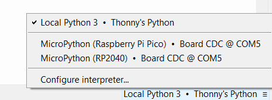
*Pick MicroPython (Raspberry Pi Pico) on the board's COM port, not Local Python 3*

### Check the board before building anything

Upload the test bitstream to the board (right-click → **Upload to /**) and run, for example:

```python
import shrike
shrike.flash("blink_all.bin")
```

If the blue FPGA LED blinks, the board, cable and Thonny all work. Fix any problem here before moving on; it saves a lot of confusion later.

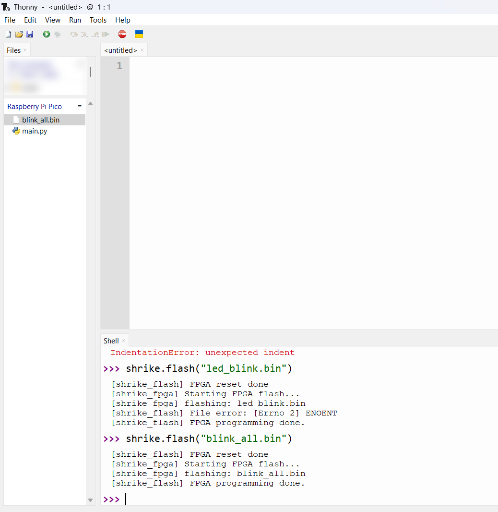
*My first board check. The first attempt failed with ENOENT because that file wasn't on the board; blink_all.bin was*

## Building the FPGA bitstream in Go Configure

The tool turns Verilog into a *bitstream*: the file that tells the FPGA how to wire itself.

```
Verilog → Synthesize → I/O Planner → Place & Route → bitstream (.bin)
```

### Step 1: Create the project

On the Go Configure home screen, click **Start new project**, search for **SLG47910** and pick **SLG47910V (Rev BB)**, the chip on the Shrike Lite. Name the project `mac_shrike` and save it in a folder without spaces.

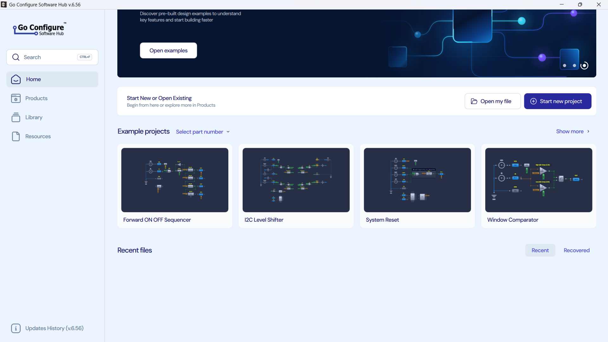
*Go Configure v6.56 home screen. Newer versions use "Start new project" instead of a Develop tab*

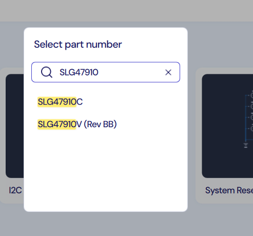
*Pick SLG47910V (Rev BB), not SLG47910C*

### Step 2: Project settings

A settings window opens. On the **Specs** tab I used the same operating conditions as Vicharak's own examples: VDDC 1.05 / 1.1 / 1.15 V, VDDIO 1.71 / 2.5 / 3.465 V, temperature −40 / 25 / 85 °C. These only tell the timing checker which conditions to assume; they do not change the board.

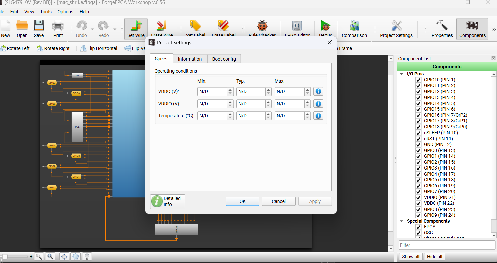
*The Specs tab, before entering the operating conditions*

On the **Boot config** tab, leave **Force Load from OTP = Disable** and **Lock status = Unlocked**. OTP is one-time memory: turning that option on can stop the RP2040 from loading designs over SPI.

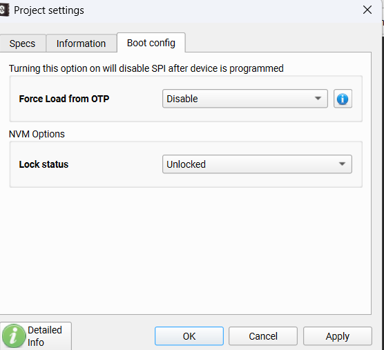
*Keep these defaults: OTP is one-time memory*

### Step 3: Paste the Verilog

The chip view opens. Leave the Properties panel at its defaults and click **FPGA Editor** on the toolbar. Open `main.v`, select everything, and paste the whole project (all three modules in one file, the top module marked `(* top *)`). Click **Save All**.

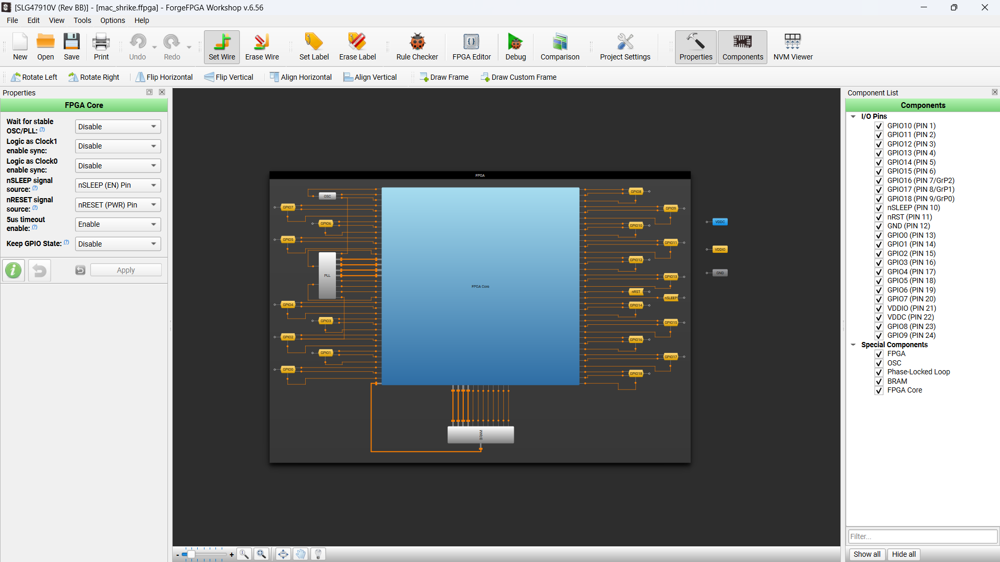
*The chip view: the big blue square is the FPGA core; the yellow boxes are the pins*

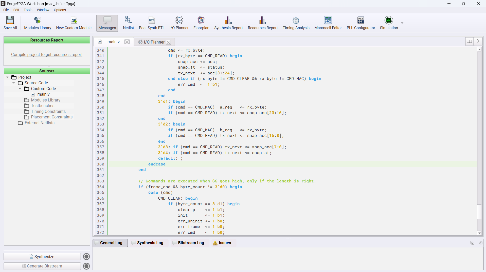
*The Verilog pasted into main.v, ready to synthesize*

### Step 4: Synthesize

Click **Synthesize** (bottom-left) and wait for the green tick. The log should end with *0 problems*. Two lines worth spotting: the multiplier was treated as **signed**, and no DSP block was used.

### Step 5: Map the pins in the I/O Planner

Open the **I/O Planner** tab. Each row is a pin function on the chip; double-click the **PORT** cell to choose your signal. Watch the `_IN` / `_OUT` / `_OE` endings carefully.

| Signal in `top.v` | Pin function |
| --- | --- |
| `clk` | OSC_CLK |
| `clk_en` | OSC_EN |
| `spi_sck` | GPIO3_IN |
| `spi_ss_n` | GPIO4_IN |
| `spi_mosi` | GPIO5_IN |
| `spi_miso` | GPIO6_OUT |
| `spi_miso_en` | GPIO6_OE |
| `rst_n` | GPIO18_IN |
| `led` | GPIO16_OUT |
| `led_en` | GPIO16_OE |

The clock rows appear under the **CLK** and **OSC_ctrl** filters; the rest under **GPIO**. Every FPGA output needs an output-enable here, which is why `led_en` and `spi_miso_en` exist.

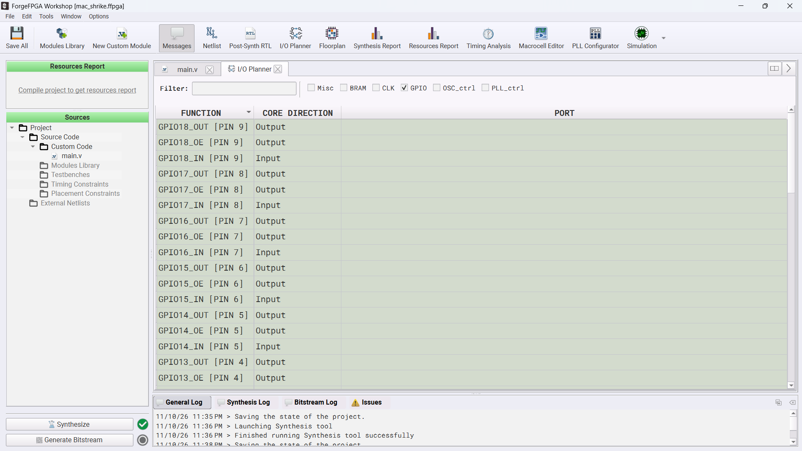
*The I/O Planner. Double-click a PORT cell to assign a signal*

### Step 6: Generate the bitstream and read the reports

Click **Save All**, then **Generate Bitstream**. Place-and-route finished with 0 errors and 4 warnings, all harmless for this design:

- *"not packed with an IOB FF"* for `spi_miso_en`, `rst_n` and `led`: these signals change at 1 MHz or slower, so a flip-flop right at the pin is not needed.
- *"Clock clk directly fed by port without CLKBUF"*: expected, because the code uses the same `clkbuf_inhibit` attribute as Vicharak's examples.

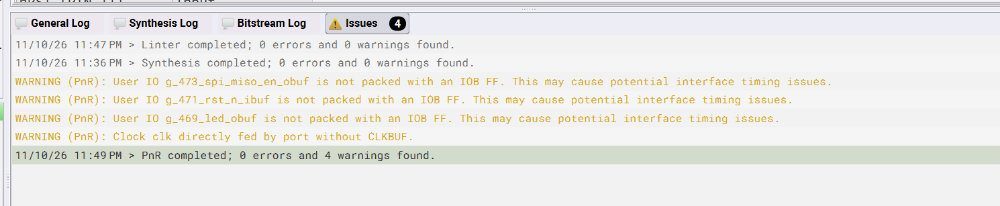
*0 errors; the 4 warnings are harmless for this design*

My resource report:

| Resource | Used | Available | % |
| --- | --- | --- | --- |
| LUT5s | 362 | 1120 | 32 % |
| Flip-flops | 163 | 1120 | 14 % |
| Logic blocks (CLBs) | 64 | 140 | 46 % |
| GPIOs | 6 | 19 | 32 % |
| PLL / BRAM | 0 | — | — |

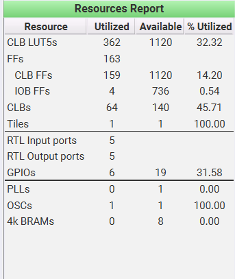
*The real resource report from Go Configure*

In **Timing Analysis**, ignore the scary negative slack: with no clock constraint the tool tests against 500 MHz. The number that matters is **Achievable Frequency: 68.6 MHz**, comfortably above the 50 MHz the oscillator actually runs at.

### Step 7: Find the file for the board

In your project folder, open `ffpga\build\bitstream\`, copy **`FPGA_bitstream_MCU.bin`** (only that one), and rename the copy to `mac_shrike.bin`. If Windows hides file extensions, rename it to just `mac_shrike` so you don't end up with `mac_shrike.bin.bin`.

## Running it on the board

The RP2040 side is three small Python files, each with one job:

| File | Job |
| --- | --- |
| `mac_protocol.py` | Command bytes, range checks, decoding, and a Python reference model of the MAC |
| `shrike_mac.py` | The `ShrikeMac` driver class: `clear()`, `mac(a, b)`, `read()` |
| `main.py` | The demo: loads the FPGA, clears, tests, prints PASS or FAIL |

`mac_protocol.py` is pure Python, so the same logic can be unit-tested on a PC without the board. The driver uses SPI0 at 1 MHz, mode 0, on the pins from the table above:

```python
self.spi = SPI(0, baudrate=1_000_000, polarity=0, phase=0, bits=8,
               firstbit=SPI.MSB, sck=Pin(2), mosi=Pin(3), miso=Pin(0))
```

### Upload and run

1. In Thonny's top (PC) panel, open the folder with your four files: `mac_shrike.bin`, `mac_protocol.py`, `shrike_mac.py`, `main.py`.
2. Right-click each one → **Upload to /**. Say yes to overwriting the board's old `main.py`.
3. Click the red **STOP** button once, double-click `main.py` in the board panel, and press **F5**.

`main.py` calls `shrike.flash("mac_shrike.bin")`, pulses the FPGA reset on GPIO14, checks the status is `0x40`, sends CLEAR, then runs the tests. Because it is named `main.py`, it also runs every time the board powers up.

### The result on my board

```
Loading mac_shrike.bin into the FPGA ...
[shrike_fpga] flashing: mac_shrike.bin
[shrike_flash] FPGA programming done.
After reset : acc = 0  status = 0x40 [-]
After CLEAR : acc = 0  status = 0x41 [INIT]
Rejected (128, 1) -> a=128 is outside signed 8-bit range -128..127
Rejected (-129, 1) -> a=-129 is outside signed 8-bit range -128..127
Rejected (1, 300) -> b=300 is outside signed 8-bit range -128..127
Rejected (True, 2) -> a must be an int, got True
Rejected (1.5, 2) -> a must be an int, got 1.5
 -128 *  -128  -> acc =    16384  (expected    16384) ok
  127 *   127  -> acc =    32513  (expected    32513) ok
 -128 *   127  -> acc =    16257  (expected    16257) ok
  127 *  -128  -> acc =        1  (expected        1) ok
   -1 *    -1  -> acc =        2  (expected        2) ok
    0 *  -128  -> acc =        2  (expected        2) ok
   64 *    -2  -> acc =     -126  (expected     -126) ok
 -100 *   100  -> acc =   -10126  (expected   -10126) ok
    3 *     5  -> acc =   -10111  (expected   -10111) ok
   -7 *     9  -> acc =   -10174  (expected   -10174) ok
1000 random MACs in 806 ms: acc = 270106, expected 270106, status 0x41 [INIT]
RESULT: PASS
```

The blue FPGA LED stays on, meaning "cleared, no errors".

One thing confused me at first: `127 * -128 -> acc = 1` looks wrong. It isn't. `acc` is the **running total**, not the answer to that one multiplication: the previous total was 16 257, and 16 257 + (−16 256) = 1.

### Try your own numbers

Type these one line at a time in the Shell:

```python
>>> mac.clear()
>>> mac.mac(10, -3)
>>> print(mac.read())
(-30, 65)
>>> mac.mac(4, 5)
>>> print(mac.read())
(-10, 65)
```

The first number is the total; 65 is the status byte 0x41.

## How I knew it was correct before touching the board

I never trust a design just because it compiles. Each layer was checked on its own before the next one was built.

| Stage | Tool | What it proved | Result |
| --- | --- | --- | --- |
| Simulation | Icarus Verilog + a self-checking testbench | Arithmetic, signed values, command framing, readback, overflow, SPI at 1, 2 and 4 MHz | 11 852 checks, 0 errors |
| Full overflow run | Same testbench | 131 072 real SPI MACs push the total past +2 147 483 647; it wraps and OVF turns on | Pass |
| Bug injection | Deliberately broken Verilog | The testbench actually catches unsigned maths, a missing overflow check, wrong byte order, a missing clear-first check | All 4 caught |
| PC unit tests | Python `unittest` | Range rejection, encoding, decoding, driver framing | 10 / 10 |
| Synthesis + place & route | Go Configure v6.56 | Fits in 32 % of the LUTs; 68.6 MHz achievable vs 50 MHz needed | Pass |
| Hardware | Shrike Lite + Thonny | 10 corner cases + 1000 random MACs match the Python model | `RESULT: PASS` |

The testbench drives the real SPI pins exactly like the RP2040 does, so it tests the whole FPGA design, not just the multiplier. The expected answers come from a separate Python model, so the Verilog and the model check each other.

The bug-injection step is the one beginners skip, and it is the most reassuring. A testbench that passes is only useful if it would also *fail* on a broken design.

## Troubleshooting

| What you see | Likely cause and fix |
| --- | --- |
| No `RPI-RP2` drive when installing MicroPython | Charge-only cable, or BOOT not held while plugging in |
| `ImportError: no module named 'shrike'` | Generic MicroPython was installed; use `shrike-lite-micropython.uf2` |
| `[shrike_flash] File error: [Errno 2] ENOENT` | The `.bin` file is not on the board, or its name is misspelled |
| `LinkError ... got ffffffffffff` or `000000000000` | FPGA not answering: wrong bitstream, or `clk`/`clk_en`/MISO pins not mapped in the I/O Planner |
| Status shows ERR_UNINIT (68) | A MAC was sent before CLEAR; call `mac.clear()` first |
| Status shows ERR_FRAME (73) | A frame had the wrong length; use the driver functions |
| Windows won't rename the `.bin` | You are inside the zip, not an extracted folder; or keep the name and change `BITSTREAM` in `main.py` |
| Timing report shows huge negative slack | No clock constraint, so the tool assumes 500 MHz; read *Achievable Frequency* instead |
| `IndentationError` in the Thonny Shell | A space before the command; type it from the start of the line |

## What I learned

- **Two chips, two jobs.** The FPGA does fixed hardware work; the microcontroller does everything else, including loading the FPGA every boot.
- **Signals from another chip must be synchronised** before you use them, and edges are found by comparing two clean samples.
- **Signed maths needs care:** use `$signed`, sign-extend before adding, and detect overflow from the sign bits.
- **Make every message atomic.** Acting only on a complete, correctly sized frame made the design much easier to trust.
- **Status codes pay for themselves.** A single status byte turned every failure into a readable message.
- **Read the right number in a report.** Negative slack against an automatic 500 MHz target is not a failure at 50 MHz.
- **Tutorials age.** Go Configure v6.56 looks different from older guides ("Start new project" instead of a Develop tab), so expect small differences.

## Wrapping up

A signed 8×8 multiplier with a 32-bit accumulator fits in about a third of the Shrike Lite's FPGA, runs well above its 50 MHz clock, and talks to the RP2040 over wires that are already on the board. For a first real FPGA project, that is a very satisfying result.

Ideas for where to go next:

- Send a whole vector in one SPI frame, so a dot product needs fewer Python calls.
- Make CLEAR + MAC a single command that starts a new total.
- Use the FPGA's block RAM to store weights, turning this into a tiny neural-network accelerator.
- Add a clock constraint file (`.sdc`) so the timing report checks against 50 MHz directly.

**Source code:** [https://github.com/Pratham7767/shrike-lite-mac](https://github.com/Pratham7767/shrike-lite-mac)

If you build this, tell me what you change. I'd love to see a faster or bigger version.

## Sources

- [Vicharak Shrike repository](https://github.com/vicharak-in/shrike) and [releases](https://github.com/vicharak-in/shrike/releases)
- [Shrike pin-outs and FPGA–MCU interconnect](https://vicharak-in.github.io/shrike/shrike_pinouts.html)
- [Shrike hardware overview](https://vicharak-in.github.io/shrike/hardware_overview.html)
- [Generating your first bitstream (Vicharak)](https://vicharak-in.github.io/shrike/generating_your_first_bitstream.html)
- [Vicharak `spi_loopback_led` example](https://github.com/vicharak-in/shrike/tree/main/examples/spi_loopback_led)
- [Renesas SLG47910 product page](https://www.renesas.com/en/products/slg47910) and [datasheet](https://www.renesas.com/en/document/dst/slg47910-datasheet)
- [Renesas Go Configure Software Hub](https://www.renesas.com/en/software-tool/go-configure-software-hub)
- [ForgeFPGA Workshop user guide](https://www.renesas.com/en/document/gde/forgefpga-workshop-user-guide)
- [MicroPython `machine.SPI`](https://docs.micropython.org/en/latest/library/machine.SPI.html)
